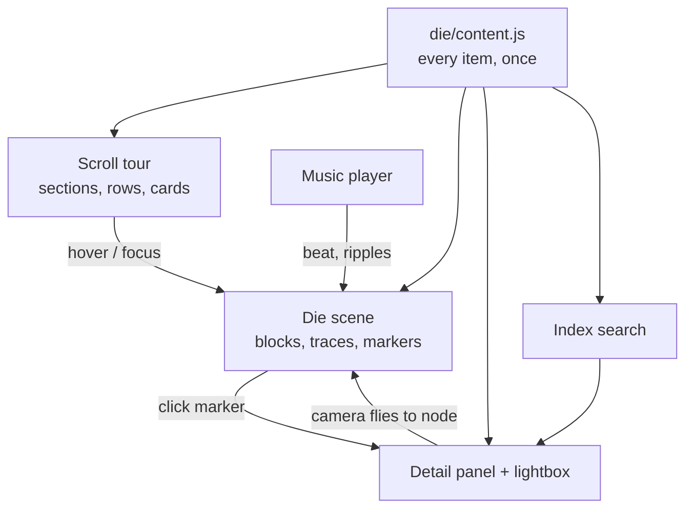

# Arihan Yadav · air-crypto.github.io

**Status:** live. One page and one WebGL scene. Every piece of work sits on a silicon die, and scrolling, the panels, the search and the music all move the same scene.

**Verified:** desktop (1440×900) and phone (390×844) in headless Chrome with WebGL, and in Safari on macOS. Deep links like `#projects/ebike` open the right panel. The tree's old links still resolve.

## How it works



- **Scroll** flies the camera block by block (About, Work, Projects, Life, I/O). A particle core above the die morphs to fit each section: chip, neural net, logic waveform, lattice, globe, beacon.
- **Hover** a row or card and its trace lights up on the die. Hover a marker on the die and the matching row lights up.
- **Click** anything to open its panel. The camera then frames that node and the list steps back. Use ← → to move through a group, and Esc to close.
- **Index** (`/`) searches everything at once.
- **Music** playing speeds up the trace packets and pulses the core.
- Photos are in full color and open in a lightbox. Reduced motion is respected.

## Files

- `index.html`: page shell, header, panel, index, lightbox, music.
- `die/content.js`: all content. Edit here to add or change work, projects, or photos.
- `die/app.js`: scene, scroll tour, panel, index, routing.
- `die/style.css`: layout and type (Instrument Serif, IBM Plex Mono, Inter; OFL).
- `die/three.module.min.js`: three.js r170 (MIT, see `die/three-LICENSE.txt`).
- `tree.html` + `forest*.js`: the previous tree version, kept and linked from the footer.
- `portfolio.html`, `projects.html`, `life.html`, `gallery.html`, `hockey.html`: plain pages, used as the no-JavaScript fallback.

## Run locally

```sh
python3 -m http.server 8765 --bind 127.0.0.1
```

Open http://127.0.0.1:8765. GitHub Pages serves `main`.
