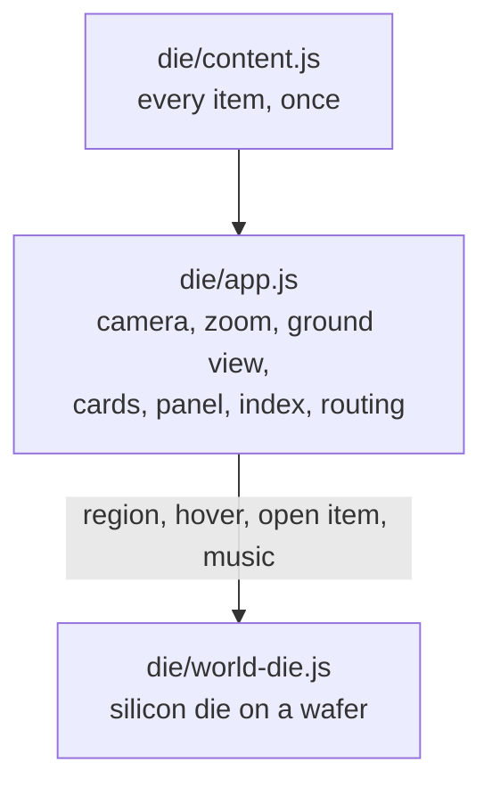

# Arihan Yadav · air-crypto.github.io

**Status:** live. One page, one scene, no scrolling. You zoom in and out of a world. Click or zoom into a region to stand in it: its items float above the horizon as cards, with dashed lines down to where they sit in the world.

**Verified:** desktop (1440×900) and phone (390×844) in headless Chrome with WebGL, and in Safari on macOS. Checked: wheel zoom into a region, then out; region label click; marker click opening its panel; drag to pan and to look; off-panel click and Esc closing; deep links (`#projects/ebike`); click on empty space returning home.

## How it fits together



- The die has a block for About, Work, Projects and Life, plus I/O pads for Contact. It sits on a wafer of dies that runs to the horizon. Standing in a block, a particle core floats over the horizon and changes shape per region.
- The home view shows the intro and no header name. Inside a region the header shows the name and "RL · systems · AI"; clicking it goes home.

## Controls

- **Overview:** scroll or pinch to zoom, drag to pan, right-drag or shift-drag to orbit. Click a region or its label, or zoom all the way in, to enter it.
- **Standing in a region:** drag to look around. Click a card for its panel; ← → step through the group. Click anywhere off the panel to close it. Click empty space, scroll out, pinch out, Esc or "← Overview" to leave.
- **Index** (`/`) searches everything.

## Files

- `index.html`: shell, header, intro, region heading, panel, index, lightbox, music.
- `die/content.js`: all content. Edit here.
- `die/app.js`, `die/world-die.js`, `die/gfx.js`, `die/style.css`.
- `die/three.module.min.js`: three.js r170 (MIT). Fonts: Instrument Serif, IBM Plex Mono, Inter (OFL).
- `tree.html` + `forest*.js`: the older tree version. `portfolio.html`, `projects.html`, `life.html`, `gallery.html`, `hockey.html`: plain no-JavaScript pages.

## Run locally

```sh
python3 -m http.server 8765 --bind 127.0.0.1
```
